# OSHI-SAIDAN

推しのグッズや飾り付けを、写真とその日の気持ちで残す投稿ギャラリーです。画像と文章を投稿し、一覧・詳細画面から振り返れます。

**[自分の保存先で使う → 導入手順](#setup)**

## このアプリでできること

- 写真と「気持ち・メモ」を組み合わせた投稿。
- 一覧のカードから詳細画面へ移動。
- 保存済みの投稿を、再読み込みやアプリの再起動後にも表示。

ログイン機能はありません。通常利用の設定では、接続情報を持つ人が投稿の閲覧・追加を行えます。画像は公開バケットに保存され、URLを知る人が閲覧できます。**「自分のSupabaseに保存する」構成であり、本人だけが閲覧できるサービスではありません。** 公開してよい写真と文章を使ってください。

### 画面例

デモモードの画面例です。画像内のキャラクター・グッズはAI生成のサンプルです。

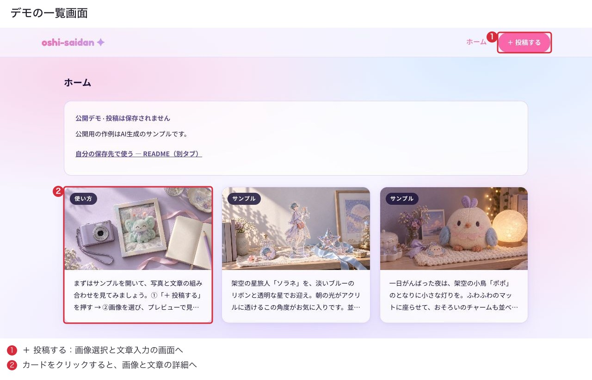

<details>
<summary>投稿画面と詳細画面を見る</summary>

**投稿画面：** 「＋ 投稿する」から開きます。画像と文章を入力するとプレビューを確認できます。デモでは入力後も保存ボタンが無効です。通常利用での保存は手順5に従ってください。

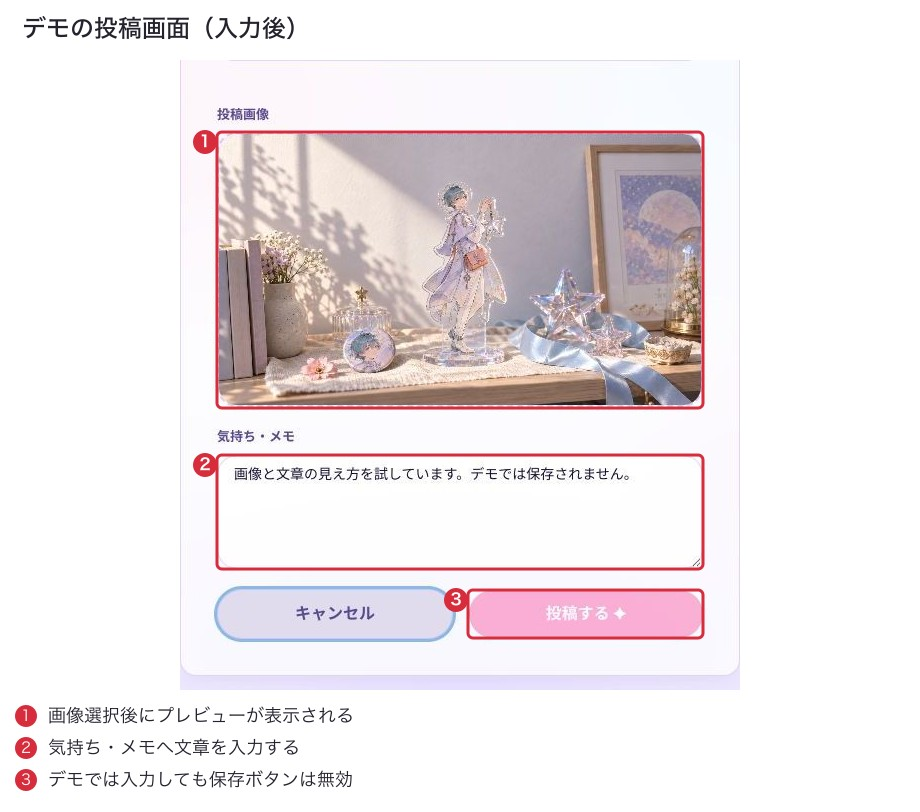

**詳細画面：** 一覧のカードから開きます。画像と文章の全文を確認できます。

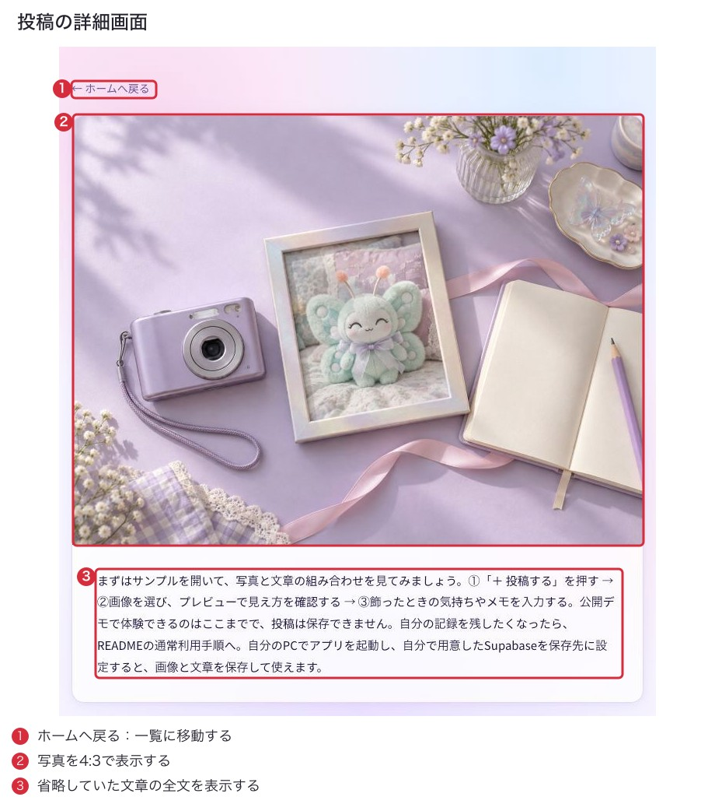

</details>

## 技術構成

| 役割 | 使用技術 |
| --- | --- |
| 画面・型 | React 19 / TypeScript |
| 起動・ビルド | Vite 7 / Node.js 22 |
| 見た目 | Chakra UI v2 |
| 画面遷移・フォーム | React Router / React Hook Form |
| データ取得 | TanStack Query |
| 投稿・画像の保存 | Supabase Database / Storage |
| 公開デモの配信先 | Firebase Hosting |
| 自動確認 | Jest / React Testing Library / GitHub Actions |

<a id="setup"></a>
## 自分の保存先で使う

ここでは、PCの準備 → アプリの取得 → Supabaseの設定 → 起動 → 保存確認の順に進みます。Firebaseの設定や、自分の公開URLを作る作業は不要です。

先に、インターネットに接続できるPC、ブラウザ、公開してよいJPEGまたはPNG画像1枚を用意してください。Supabaseのアカウントは手順3で作成します。上の画面例のサンプル3件は、自分の保存先には自動で追加されません。

| 手順 | 終わったときの状態 |
| --- | --- |
| [1. Windows・Macの準備](#setup-tools) | Git・Node.js・npmのバージョンが表示される |
| [2. アプリを取得する](#setup-download) | PCにアプリのフォルダができ、パッケージの準備が終わる |
| [3. Supabaseを用意する](#setup-supabase) | 投稿テーブル・画像バケット・権限を設定し、接続情報を取得できる |
| [4. 接続情報を入力する](#setup-env) | `.env`に自分のURL・公開用キー・通常モードの設定が保存される |
| [5. 起動・保存確認](#setup-save) | 自分が投稿した画像と文章を、一覧・詳細・保存先で確認できる |
| [6. 停止・再起動](#setup-restart) | アプリを起動し直しても保存済みの投稿が表示される |

**手順の読み方：** コマンドは灰色の枠内の文字を1行ずつターミナルへ貼り付け、Enterで実行します。処理が終わって入力待ちに戻ってから次の行へ進んでください。SQLはターミナルではなく、指定したSupabaseのSQL Editorで実行します。スクショの赤い番号は操作場所の目印で、入力する文字ではありません。細部が読みにくい場合は画像をクリックして拡大してください。

<a id="setup-tools"></a>
### 1. Windows・Macの準備

Gitはアプリのファイルを取得する道具、Node.jsはPC上でアプリを起動するための実行環境です。npmはNode.jsに付属し、アプリが使うパッケージを揃えます。

**Windows**

1. [Git for Windows](https://git-scm.com/install/windows)からインストーラーを入手し、インストールします。コマンドラインからGitを使える既定の設定を選びます。
2. [Node.js 22.15.0](https://nodejs.org/en/download/archive/v22.15.0)の「Installer Packages」でPCに合うWindows用 `.msi` を選んでインストールします。一般的なIntel・AMDのPCはx64、ARM搭載PCはARM64です。
3. スタートメニューで「コマンド プロンプト」を検索して開きます。以下のWindows用コマンドは、この画面で実行します。

**Mac**

1. `⌘ + Space` を押し、「ターミナル」と入力して開きます。
2. `git --version` を入力します。開発者ツールのインストール案内が出た場合は「インストール」を選び、完了を待ちます。詳しくは[Git公式のMac向け案内](https://git-scm.com/install/mac)を参照してください。
3. [Node.js 22.15.0](https://nodejs.org/en/download/archive/v22.15.0)の「Installer Packages」でmacOS用 `.pkg` を選び、インストールします。

**両OS共通の確認**

インストール後はターミナルを閉じて開き直し、1行ずつ実行します。

```text
git --version
node --version
npm --version
```

成功すると各バージョンが表示されます。動作確認環境は **Node.js 22.15.0 / npm 10.9.2** です。CIも[.nvmrc](.nvmrc)のNode.jsバージョンを使用します。Vite 7の要件に合わせ、22系では22.12.0以上が必要です。**Windowsでの実行と、新規環境での導入手順全体は未検証です。**

<a id="setup-download"></a>
### 2. アプリを取得する

**Windows（コマンド プロンプト）**

```bat
cd /d "%USERPROFILE%"
git clone https://github.com/kooooo1tktn/oshi-saidan.git
cd oshi-saidan
npm ci
```

**Mac（ターミナル）**

```bash
cd ~
git clone https://github.com/kooooo1tktn/oshi-saidan.git
cd oshi-saidan
npm ci
```

1行ずつ実行してください。`cd` は作業するフォルダを移動する命令です。取得後の場所は、Windowsではユーザーフォルダ内の `oshi-saidan`、Macではホームフォルダ内の `oshi-saidan` です。

既に同じ場所に `oshi-saidan` フォルダがある場合は、上書きや削除をせず、別の作業用フォルダへ `cd` で移動してから `git clone` 以降を実行してください。その場合、以後は新しく取得した `oshi-saidan` フォルダで操作します。

成功すると、そのフォルダに `README.md` や `package.json` があり、`npm ci` の終了後に入力待ちへ戻ります。`npm ci` は記録済みのバージョンを使うため、作者と同じ依存パッケージを揃えやすくなります。エラーで終了した場合は、先へ進まず[困ったとき](#troubleshooting)を確認してください。

<a id="setup-supabase"></a>
### 3. 自分のSupabaseプロジェクトを用意する

Supabaseは、投稿の文章を入れるDatabase（データベース）と、画像ファイルを入れるStorage（ストレージ）を提供します。バケットは、Storage内で画像をまとめる入れ物です。この手順では**新しい専用プロジェクト**を使います。以降の設定はすべて同じプロジェクトで行ってください。

#### 3-1. プロジェクトを作成する

1. [Supabase Dashboard](https://supabase.com/dashboard)を開き、アカウントを作成してログインします。
2. **New project** を開き、作成先のOrganization（組織）を選びます。無料で始める場合はFreeプランの組織を選んでください。
3. プロジェクト名（例：`my-oshi-saidan`）、データベース用パスワード、リージョン（例：RegionのSpecific regionsにある **Northeast Asia (Tokyo)**）を入力します。パスワードは安全な場所に保管し、このアプリの `.env` には入力しません。GitHubとの接続は不要です。
4. Securityの **Enable Data APIをON**、**Automatically expose new tablesをOFF** にします。Enable automatic RLSはOFFのままで構いません。次の手順のSQLで、必要なテーブルの権限とRLSを明示的に設定します。
5. 作成画面で費用と利用可能な枠を確認し、**Create new project** を押します。有料プランへの変更はこの手順に含みません。
6. 準備が終わり、プロジェクトのDashboardを開ける状態になったら次へ進みます。

**入力画面の例：** パスワードは未入力で撮影しています。自分で設定してから作成してください。

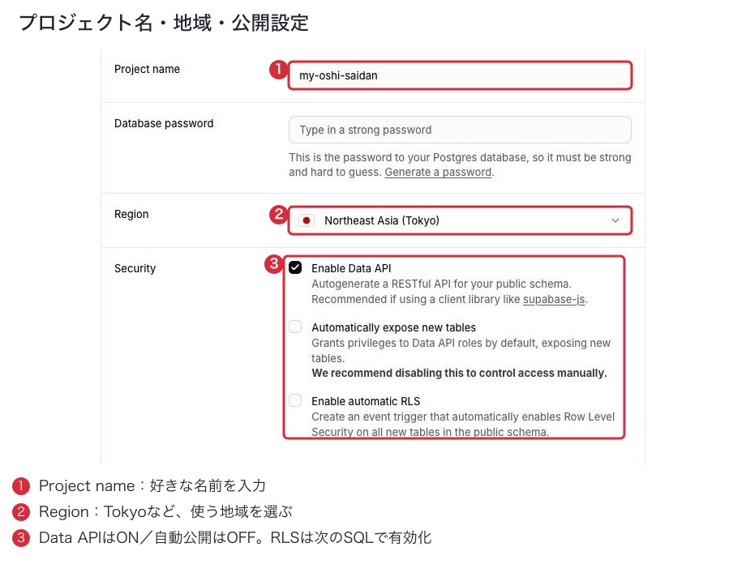

Freeプランでも利用上限があります。作成時の表示と[Supabaseの料金・無料枠の説明](https://supabase.com/docs/guides/platform/billing-on-supabase)を確認してください。既にプロジェクトがある場合も、以下のテーブル・バケット・権限の確認は省略しません。

#### 3-2. 投稿テーブルを作成する

**開く画面：対象プロジェクト → SQL Editor → New query。** 新しい専用プロジェクトで、`public.posts` がまだ存在しない場合に、次のSQLの `begin;` から `commit;` までをまとめて貼り付けて **Run** を1回押します。途中の一部だけを選択せず、全体を実行してください。

<!-- setup-posts:start -->
```sql
begin;

create table public.posts (
  id bigint generated by default as identity primary key,
  description text not null,
  image_url text not null,
  created_at timestamptz not null default now()
);

alter table public.posts enable row level security;

-- テーブルを操作できる権限と、行を操作できるRLSの両方を設定する。
revoke all on table public.posts from anon, authenticated;
grant select, insert on table public.posts to anon, authenticated;
grant usage on sequence public.posts_id_seq to anon, authenticated;

create policy "posts_select"
  on public.posts for select to anon, authenticated
  using (true);

create policy "posts_insert"
  on public.posts for insert to anon, authenticated
  with check (true);

commit;
```
<!-- setup-posts:end -->

**成功した状態：** SQL Editorに成功が表示され、**Table Editor → posts** に次の4列があります。まだデータが0件でも正常です。

| 列 | 型・設定 | 保存するもの |
| --- | --- | --- |
| `id` | bigint / 主キー / BY DEFAULTの自動採番 | 投稿の番号 |
| `description` | text / NULL不可 | 入力した文章 |
| `image_url` | text / NULL不可 | 画像の保存パス（画像そのものやURL全体ではありません） |
| `created_at` | timestamptz / NULL不可 / 初期値 `now()` | 作成日時 |

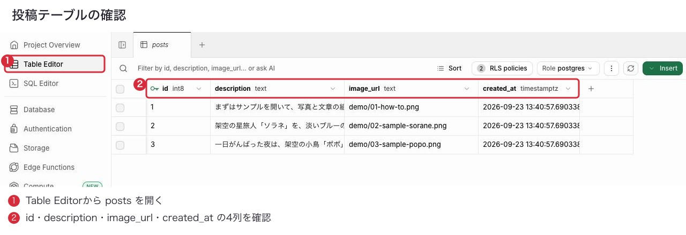

画面例には作者のサンプル3件があります。新規作成直後は0件で、同じ4列があれば正常です。`int8` は `bigint` の別名です。

RLSは「この行への操作を許可するか」を判定する仕組みです。ここではログインなしの閲覧・追加を許可します。更新・削除の権限は与えず、それらのポリシーも作りません。管理者は別の権限を持ちます。ログインで所有者ごとに制限する方法もありますが、今回はログインを導入しないため、その分離はありません。[公式：RLS](https://supabase.com/docs/guides/database/postgres/row-level-security)

<details>
<summary>既にpostsがある場合の確認（新規作成できた場合は次へ）</summary>

作成SQLを再実行せず、以下の確認SQLを**1枠ずつ**SQL Editorの新しいクエリへ貼り付け、Runで実行して照合します。結果が異なる場合は、既存データを削除したり、RLSを無効にしたりせず、表示された差を確認してください。

**列の確認：** 上の4列の表と照合します。`is_nullable`の`NO`はNULL不可を表します。

```sql
select column_name, data_type, is_nullable, column_default,
       is_identity, identity_generation
from information_schema.columns
where table_schema = 'public' and table_name = 'posts'
order by ordinal_position;
```

**RLSの確認：** `rls_enabled`が`true`なら有効です。

```sql
select relrowsecurity as rls_enabled
from pg_class where oid = 'public.posts'::regclass;
```

**行への操作の確認：** `cmd`がSELECT・INSERTの2件で、対象は`anon`・`authenticated`、条件は`true`です。

```sql
select policyname, roles, cmd, qual, with_check
from pg_policies
where schemaname = 'public' and tablename = 'posts';
```

**テーブル権限の確認：** `anon`・`authenticated`にSELECT・INSERTがあり、UPDATE・DELETEやPUBLICへの権限がないことを確認します。

```sql
select grantee, privilege_type
from information_schema.role_table_grants
where table_schema = 'public' and table_name = 'posts'
  and grantee in ('anon', 'authenticated', 'PUBLIC');
```

ポリシー名自体は異なっても構いません。既存テーブルの列や制約が上の表と異なる場合は、その違いを確認してから利用してください。

</details>

<details>
<summary>SQL Editorの実行場所・結果を見る</summary>

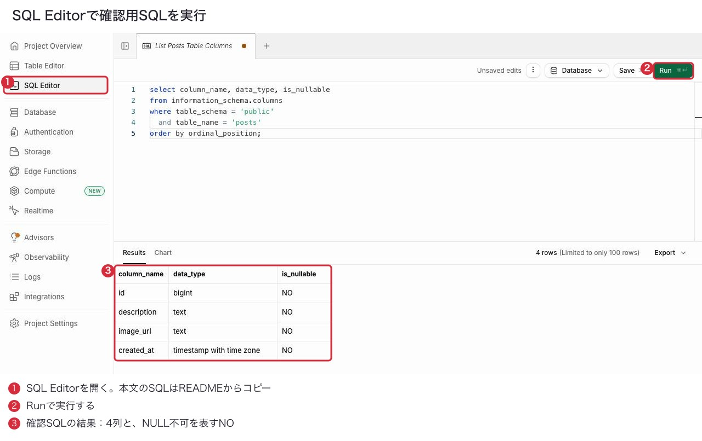

この画像は列の確認SQLを実行した例です。テーブル作成SQLの成功画面ではありません。SQLの入力欄へ本文のコードを貼り、Runで実行し、下のResultsを確認します。

</details>

#### 3-3. 画像用バケットを作成する

**開く画面：Storage → Files → Buckets → New bucket。** 名前に `post-images` を入力し、**Public bucketをON** にして作成します。画像の公開URLを使って表示するために必要です。

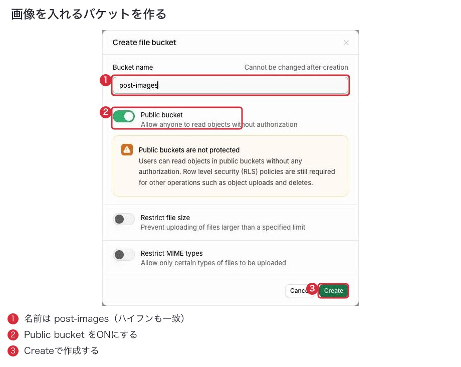

**成功した状態：** Storageの一覧に `post-images` が表示され、Publicと確認できます。新規導入では、バケット固有のファイルサイズ上限・MIME制限は追加しません。Supabase側のプラン上限は適用されます。画像選択欄の `image/*` はブラウザの選択支援であり、サーバーの形式検査ではありません。

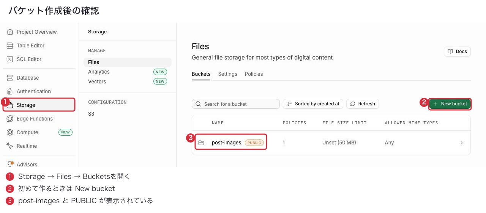

次に **SQL Editor → New query** で以下を実行し、画像の新規アップロードを許可します。

<!-- setup-storage:start -->
```sql
create policy "post_images_insert"
  on storage.objects for insert to anon, authenticated
  with check (bucket_id = 'post-images');
```
<!-- setup-storage:end -->

**成功した状態：** StorageのPoliciesで、`post-images` を対象にINSERTを許可するポリシーを確認できます。Public設定は画像の閲覧を許可しますが、アップロードの許可はこのポリシーが必要です。既存画像の上書き・削除は許可しません。[公式：Storageのアクセス制御](https://supabase.com/docs/guides/storage/security/access-control)

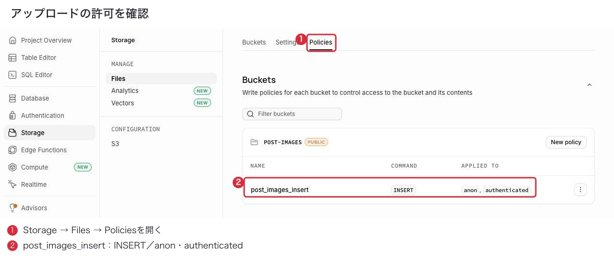

<details>
<summary>ポリシーのバケット条件を確認する</summary>

`post_images_insert` を開くと、次の条件を確認できます。SQLで設定済みなので、確認後は保存せず閉じます。画面に表示される `::text` は文字列の型を表すもので、比較対象は同じ `post-images` です。

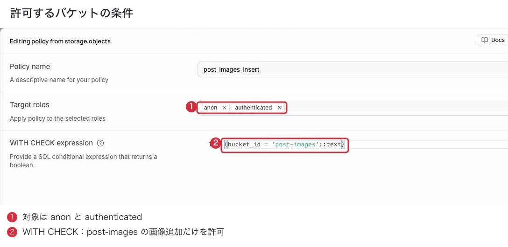

</details>

<details>
<summary>既存バケットの設定をSQLで確認する</summary>

既存バケットでも、名前・Public・アップロード権限を確認してください。以下は1枠ずつSQL Editorの新しいクエリで実行します。

**バケット：** `id`が`post-images`、`public`が`true`であることを確認します。

```sql
select id, public, file_size_limit, allowed_mime_types
from storage.buckets where id = 'post-images';
```

**ポリシー：** Storageの全ポリシーが表示されます。他のバケットを対象としたポリシーとは区別し、`post-images`に対してINSERTだけを許可していることを確認します。`ALL`や、全バケットを許可する条件がないかも確認します。

```sql
select policyname, roles, cmd, qual, with_check
from pg_policies
where schemaname = 'storage' and tablename = 'objects';
```

</details>

#### 3-4. 接続情報を取得する

**URL：対象プロジェクト → Integrations → Data API。** API URLをコピーします。表示が `https://...supabase.co/rest/v1/` の場合は、**末尾の `/rest/v1/` を外し、`https://...supabase.co` だけ**をアプリの設定に使います。Enable Data APIはONであることを確認します。

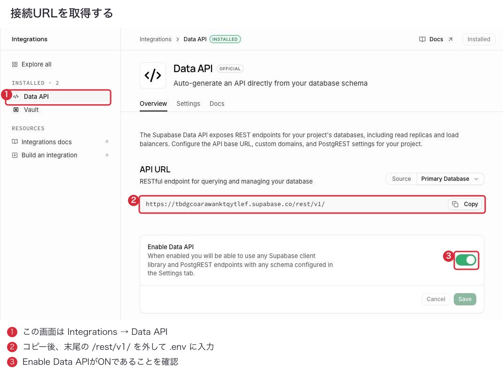

画像内のURLは説明用の例です。画像から書き写さず、**自分のDashboardのCopy**で取得してください。

**公開用キー：Project Settings → API Keys。** **Publishable and secret API keys** タブの **Publishable key** をコピーします。既存の **Legacy anon, service_role API keys** にある `anon` も利用できます。キーの値はスクショの外にあります。Secret keyを選ばないでください。

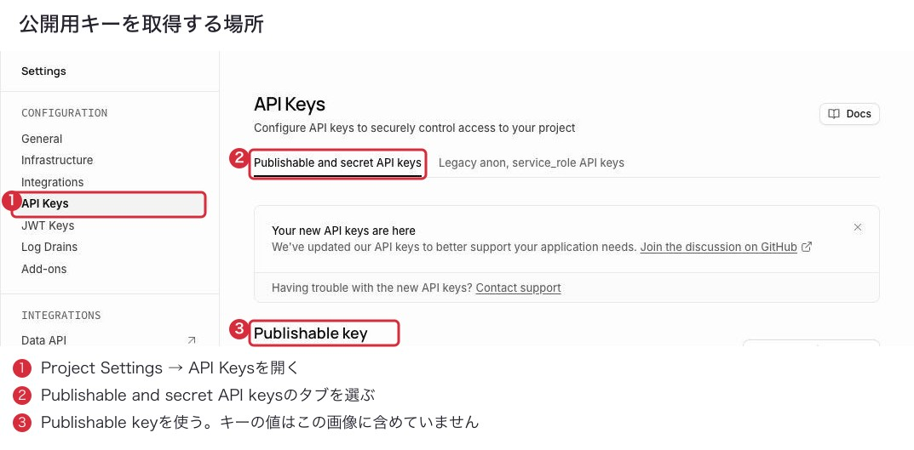

| 取得する値 | アプリの設定名 | 扱い |
| --- | --- | --- |
| Project URL（`https://...supabase.co`） | `VITE_SUPABASE_URL` | 自分のプロジェクトのURL |
| Publishable key（`sb_publishable_...`）またはlegacy `anon` | `VITE_SUPABASE_ANON_KEY` | ブラウザで利用する公開用キー。変数名は互換性のためそのまま |
| Secret key / `service_role` / DBパスワード | 設定しない | 管理用の秘密情報。README・コード・画像・動画にも含めない |

**成功した状態：** URLと公開用キーが同じプロジェクトから取得できています。公開用キー自体は利用者に見える前提なので、データへのアクセスはキーを隠すことではなく権限とRLSで制御します。[公式：APIキー](https://supabase.com/docs/guides/api/api-keys)

<a id="setup-env"></a>
### 4. `.env` に接続情報を入力する

アプリを取得したターミナルで実行します。既に `.env` がある場合はコピーで上書きせず、そのファイルを編集します。

**Windows（コマンド プロンプト）**

```bat
copy .env.example .env
notepad .env
```

**Mac（ターミナル）**

```bash
cp .env.example .env
open -e .env
```

`.env`は、アプリが使う接続先を記録するファイルです。開いたファイルの次の2項目を編集します。左側の名前と`=`は残し、右側の説明部分を、取得した値全体に置き換えます。`<`と`>`は残しません。2項目を末尾へ追加するのではなく、既存の同名の行を書き換えてください。

```dotenv
VITE_SUPABASE_URL=<自分のProject URL>
VITE_SUPABASE_ANON_KEY=<同じプロジェクトの公開用キー>
```

Macのテキストエディットでは、保存前に「フォーマット」メニューを確認します。「標準テキストにする」が出ている場合は選択してください。「リッチテキストにする」が出ている場合は、既に標準テキストなので変更不要です。

Windowsは`Ctrl + S`、Macは`⌘ + S`で開いた`.env`を上書き保存し、エディターを閉じます。

**成功した状態：** `package.json`と同じフォルダに、拡張子`.txt`の付いていない`.env`があります。

`.env` はGit管理の対象外です。Viteの `VITE_` 変数はブラウザ用ファイルに埋め込まれるため、管理用の秘密情報は入力しません。変更後は開発サーバーを再起動します。公開用ビルドなら再ビルドが必要です。[公式：Viteの環境変数](https://vite.dev/guide/env-and-mode)

<a id="setup-save"></a>
### 5. 起動し、保存を確認する

アプリのフォルダで実行します。

```bash
npm run dev
```

**成功した状態：** ターミナルに `Local: http://localhost:5173/` のようなURLが表示されます。表示されたURLをブラウザで開きます。ポート番号が違う場合も、実際に表示されたURLを使用します。ターミナルは起動したままにしてください。

自分のSupabaseを使う通常モードでは、画面例の「公開デモ」の案内は表示されません。案内が出る場合は、既存の`.env`に`VITE_DEMO_MODE=true`が残っていないか確認してください。その行を削除して保存し、手順6の方法で開発サーバーを再起動します。

1. 一覧画面を開きます。初回は「まだ投稿がありません」と表示されれば正常です。
2. ヘッダーの「＋ 投稿する」から「新しい投稿」を開きます。
3. 「投稿画像」をクリックし、公開してよい小さなJPEGまたはPNG画像を選びます。画面内にプレビューが出ることを確認します。
4. 「気持ち・メモ」に文章を入力します。入力欄の外をクリックすると入力確認が行われます。
5. 「投稿する ✦」を押します。処理中はボタンがローディング表示になり、成功すると一覧へ戻ります。
6. 投稿が見当たらなければ一覧を再読み込みし、画像と文章を確認します。カードを開き、詳細画面でも同じ内容が出ることを確認します。
7. 詳細画面を再読み込みします。画像と文章が残っていれば、表示だけでなく保存後の再取得を確認できます。
8. Supabaseの **Table Editor → posts** を開き、入力した文章が`description`列にあることと、同じ行の`image_url`を確認します。例えば`posts/abc…`なら、**Storage → Files → post-images → posts** 内の`abc…`という名前の画像に対応します。末尾の名前は投稿ごとに変わり、元の画像ファイル名とは異なります。

これで、文章がDatabase、画像がStorageに保存されたことを照合できます。次はアプリを起動し直しても表示できるか確認します。

<a id="setup-restart"></a>
### 6. 停止・再起動する

起動中のターミナルで **Ctrl + C** を押すと停止します。Windowsでバッチジョブ終了の確認が出たら `Y` を入力します。入力待ちに戻れば停止できています。Supabaseに保存済みの投稿は残ります。

次回はターミナルを開き、以下を実行します。`npm ci` やSupabaseの作成をやり直す必要はありません。

**Windows**

```bat
cd /d "%USERPROFILE%\oshi-saidan"
npm run dev
```

**Mac**

```bash
cd ~/oshi-saidan
npm run dev
```

手順2で別の作業用フォルダを選んだ場合は、上の `cd` の移動先を、その中の `oshi-saidan` に置き換えてください。

表示されたLocalのURLを開き、先ほど投稿した画像と文章が一覧・詳細に残っていることを確認します。

**導入完了の目安：** 次のすべてを確認できれば、自分の保存先で使う準備ができています。

- 画像と文章を投稿でき、一覧・詳細に表示される。
- DBの文章・保存パスと、Storageの画像が対応している。
- ページの再読み込み後と、アプリの停止・再起動後にも表示される。

<a id="troubleshooting"></a>
## 困ったとき

まずエラーの最初の1行と、どの手順で止まったかを確認してください。相談時はその2点を伝え、キーやパスワードは隠してください。

| 表示・症状 | 確認する場所と対処 |
| --- | --- |
| `git` / `node` / `npm` が見つからない | 手順1のインストール後にターミナルを開き直し、バージョン確認を実行します。 |
| `Repository not found`、取得時に認証を求められる | 取得URLを確認し、ブラウザでリポジトリを開けるか確かめます。閲覧権限が必要な場合は、所有者に確認してください。 |
| 取得先のフォルダが既に存在する | 既存フォルダを削除せず、既に取得したアプリかを確認します。 |
| `package.json` が見つからない / `ENOENT` | `oshi-saidan` フォルダへ移動したか、Windowsは `dir`、Macは `ls` で確認します。 |
| PowerShellで `npm.ps1` を実行できない | このREADMEはWindowsでは「コマンド プロンプト」を使用します。そちらを開いて同じフォルダへ移動します。 |
| Node.jsの対応バージョンに関するエラー | `node --version` と手順1を照合します。 |
| `relation "posts" already exists` / policyが既に存在する | 作成SQLの再実行を止め、手順3の既存設定確認に進みます。 |
| `supabaseUrl is required` / `supabaseKey is required` / `Invalid API key` | `.env` の名前・保存場所・空欄・URLと公開用キーの組み合わせを確認し、開発サーバーを再起動します。URLに `/rest/v1/` が付いていたら取り除きます。 |
| `Could not find the table` / `permission denied for table posts` | `public.posts` の存在、Data APIの有効状態・公開スキーマ `public`、SELECT・INSERT権限を確認します。 |
| `Bucket not found` / 画像アップロード失敗 / `row-level security` | `post-images` の名前とStorageのINSERTポリシーを確認します。RLSをOFFにして解消しないでください。 |
| DBへの保存に失敗した | `posts` のINSERT権限・ポリシー・必須列を確認します。画像アップロード後にDB保存するため、画像だけ残る場合があります。 |
| 投稿ボタンが有効にならない | 画像と文章の両方を入力し、入力欄の外をクリックします。「公開デモ」の案内も出ている場合は、手順5の案内に従って設定を確認します。デモでは投稿ボタンが無効になります。 |
| 投稿後の一覧にすぐ反映されない | 一覧を再読み込みします。DB・Storageにも保存があるか、手順5で確認します。 |
| 画像だけ表示されない | バケットがPublicか、`image_url` が `posts/...` という実在する保存パスかを確認します。 |
| `Failed to fetch` / 取得失敗 | 通信状態、Project URL、Supabaseプロジェクトが稼働中かを確認します。Freeプロジェクトが停止中ならDashboardの案内を確認します。 |

## 開発・確認

```bash
npm run lint
npm test -- --runInBand
npm run build
```

CIはPRとmainへのpushでlint・テスト・通常設定／デモ設定のビルドを行います。確認用のダミー接続情報を使い、本番Secretsは不要です。ビルド成功は、実際の保存やデモの書き込み拒否を保証するものではありません。

開発に参加する場合は[CONTRIBUTING.md](CONTRIBUTING.md)を参照してください。

## ライセンス

コードとドキュメントは[MITライセンス](LICENSE)です。画像素材は対象外です。[素材の利用条件](docs/ASSETS.md)と[第三者ライセンス](public/THIRD_PARTY_NOTICES.txt)も参照してください。
